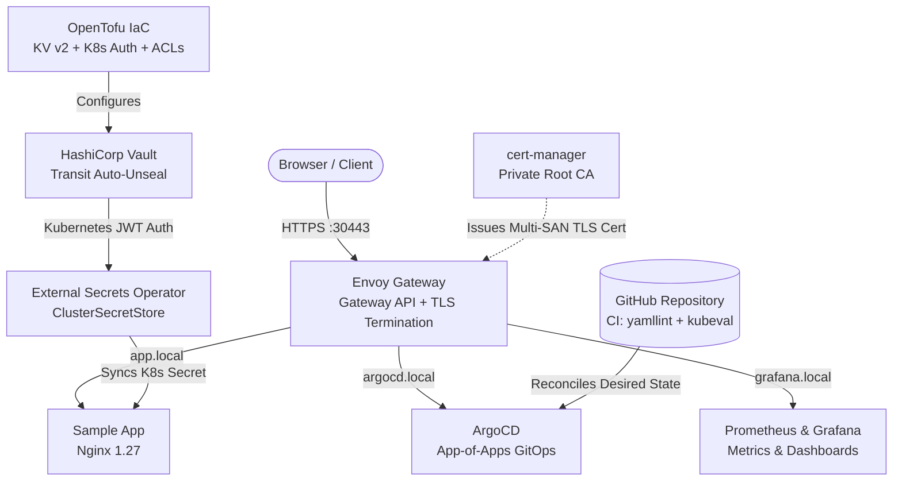

# Kubernetes GitOps & Zero-Trust Platform

Production-grade Kubernetes platform built on **k3s** implementing **GitOps (ArgoCD)**, **Gateway API (Envoy Gateway)**, **Zero-Trust Secrets Management (HashiCorp Vault + External Secrets Operator)**, **Infrastructure as Code (OpenTofu)**, and **Full-Stack Observability (Prometheus & Grafana)**.

---

## Architecture Overview



---

## Tech Stack

| Layer | Technology | Role & Design Choice |
| :--- | :--- | :--- |
| **Kubernetes** | k3s (Lightweight K8s) | Single-node cluster with built-in Traefik disabled for clean edge routing |
| **GitOps Engine** | ArgoCD (App-of-Apps) | Declarative continuous delivery with `automated` sync, `prune`, and `selfHeal` |
| **Ingress / Routing** | Envoy Gateway (Gateway API) | Modern Kubernetes Gateway API (`HTTPRoute`) with centralized edge TLS termination |
| **PKI & TLS** | cert-manager | Private Root CA (`ClusterIssuer`) issuing multi-SAN X.509 certificates |
| **Secrets Management** | HashiCorp Vault + ESO | Transit auto-unseal via `systemd` + `ClusterSecretStore` using Kubernetes JWT auth |
| **Infrastructure as Code** | OpenTofu (`v1.13`) | Declaratively manages Vault KV v2 mounts, Kubernetes auth backend, and ACL policies |
| **Observability** | kube-prometheus-stack | Prometheus metrics scraping, Alertmanager, and Grafana dashboards |
| **CI Quality Gates** | GitHub Actions | Automated `yamllint` and `kubeval` manifest validation on every Pull Request |

---

## Repository Structure

```text
k8s-gitops-platform/
├── .github/workflows/        # CI pipeline (yamllint + kubeval schema validation)
├── apps/
│   └── sample-app/           # Workload consuming Vault secrets via ESO + Gateway HTTPRoute
├── clusters/local/
│   ├── argocd-apps/          # Root App-of-Apps & child ArgoCD Application manifests
│   ├── argocd/               # ArgoCD Helm configuration
│   ├── cert-manager/         # Private Root CA & ClusterIssuer manifests
│   ├── envoy-gateway/        # EnvoyProxy NodePort config, Gateway, Certificate & HTTPRoutes
│   ├── external-secrets/     # External Secrets Operator Helm values
│   ├── external-secrets-config/ # ClusterSecretStore & ExternalSecret definitions
│   ├── kube-prometheus-stack/   # Prometheus, Alertmanager & Grafana Helm values
│   └── vault/                # Vault Raft storage & Transit auto-unseal configuration
└── infra/
    └── opentofu/             # Modular HCL code managing Vault KV v2, K8s Auth & ACLs
```
## Key Engineering & Security Highlights

* **Zero Secrets in Git:** HashiCorp Vault stores secrets in a versioned **KV v2** engine, and **External Secrets Operator** syncs them into native Kubernetes `Secret` objects via short-lived Kubernetes ServiceAccount JWT tokens.
* **Vault Transit Auto-Unseal:** Configured a host-level `systemd` unseal Vault instance using the Transit secrets engine so the primary Kubernetes Raft Vault cluster unseals automatically after node reboots without manual unseal keys.
* **Gateway API & Centralized Edge TLS:** Implemented Kubernetes **Gateway API** (`Gateway` + cross-namespace `HTTPRoute`s) with Envoy Gateway, terminating TLS at the cluster edge using a single multi-SAN certificate (`argocd.local`, `grafana.local`, `app.local`) issued by `cert-manager`.

---

## Exposed Platform Services

| Service | Local Hostname | Port | Routing Layer |
| :--- | :--- | :--- | :--- |
| **ArgoCD UI** | `argocd.local` | `30443` (HTTPS) | Envoy Gateway `HTTPRoute` |
| **Grafana Dashboards** | `grafana.local` | `30443` (HTTPS) | Envoy Gateway `HTTPRoute` |
| **Sample App (Vault-backed)** | `app.local` | `30443` (HTTPS) | Envoy Gateway `HTTPRoute` |
